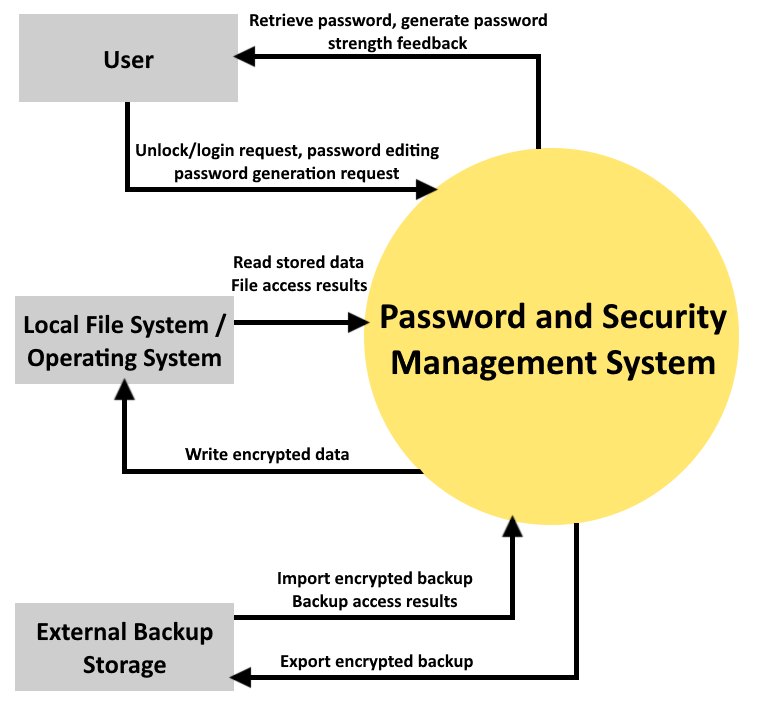

2.1 Product perspective and context

The system boundary points out the functionality developed by the project team for the password and security management system, which includes password management, credential encryption, and localized vault handling. The diagram includes optional external integrations: external backup storage.
