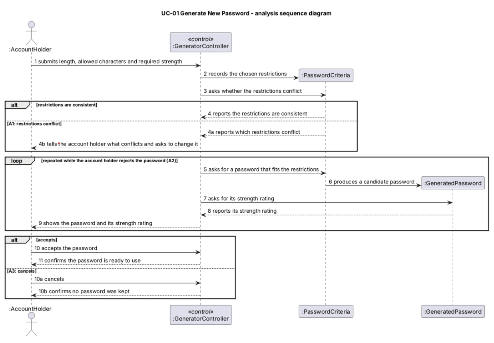
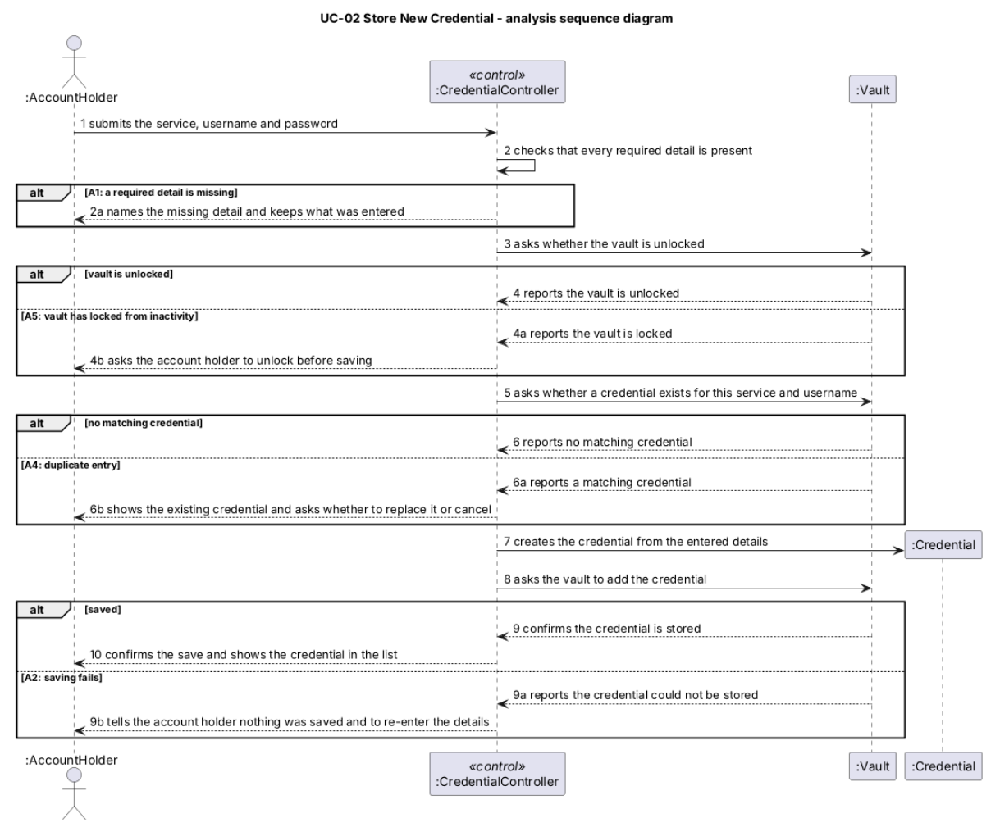
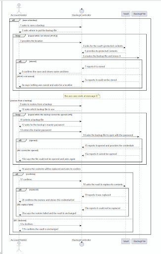

# 
5.2 Object Interaction Models

### 5.2.1 UC-01 Generate New Password

(c) Analysis Sequence Diagram

  

### 5.2.2 UC-02 Store New Credential

(c) Analysis Sequence Diagram

  

### 5.2.3 UC-03 Save and Restore Encrypted Backup

(c) Analysis Sequence Diagram

  

